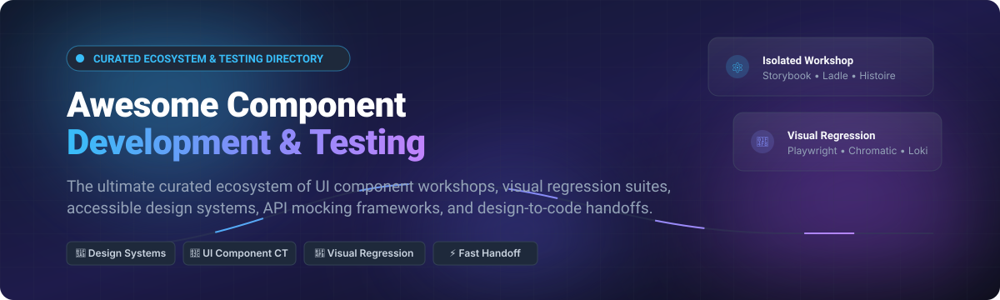
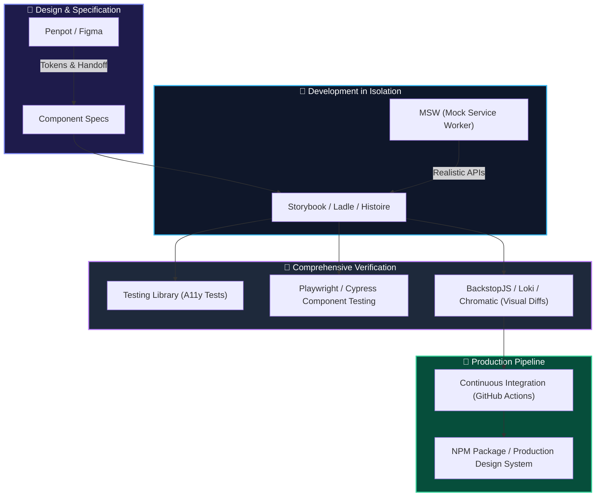

# 🎨 Awesome Component Development & Testing 🧪

  

  
  
  
  
  
  
  

  <strong>Curated Directory of Top Component Development, UI Workshops, Visual Testing &amp; Design System Handoff Ecosystems</strong> 🚀 
  <em>Comparing SaaS Platforms &amp; Open-Source Projects for Component-Driven Engineering</em>

---

## 📌 Overview & SEO Summary

Welcome to the definitive **Component Development & Testing Ecosystem** guide! This repository tracks premier **SaaS platforms** and battle-tested **open-source tools** engineered for **Component-Driven Development (CDD)**, **visual regression testing**, **isolated UI component workshops**, **accessible design systems**, and **design-to-code handoffs**.

Whether you are building micro-frontends in React, Vue, Svelte, or Angular, or automating visual diffs in CI/CD pipelines, this directory delivers actionable comparisons across features, community traction, valuations, and exact pricing models.

* **Keywords**: Component Development, Visual Regression Testing, Storybook Alternatives, Design Systems, UI Component Testing, Playwright Component Testing, Cypress Component Testing, Mock Service Worker, Penpot, Framer, Figma, Ladle, Chromatic, Frontend Engineering.

---

## 📑 Table of Contents

- [📊 Sector Overview & Market Dynamics](#-sector-overview--market-dynamics)
- [☁️ SaaS & Hosted Platforms](#️-saas--hosted-platforms)
- [🔓 Open-Source GitHub Projects](#-open-source-github-projects)
  - [🏆 High-Star Repositories (Ranked)](#-high-star-repositories-ranked)
  - [🧩 Specialized Tooling & CI Runners](#-specialized-tooling--ci-runners)
- [🛠️ Architectural Blueprint: Building a Modern Component Stack](#️-architectural-blueprint-building-a-modern-component-stack)
- [🤝 How to Contribute](#-how-to-contribute)
- [💖 Support & Sponsorship](#-support--sponsorship)
- [📈 Star History](#-star-history)
- [📜 Disclaimer](#-disclaimer)

---

## 📊 Sector Overview & Market Dynamics

The global UI/UX design and prototyping software market is estimated at **$2.6B–$2.9B in 2026**, expanding at an aggressive CAGR of **~22%–32%** toward over **$11B–$15B** by the mid-2030s. 

Market dynamics demonstrate a **highly concentrated, "winner-take-most"** reality anchored by enterprise giants:
- **Ecosystem Core**: Figma and Adobe dominate standard vector design, design system specifications, and broad organizational adoption.
- **Differentiated Frontiers**: Niche innovators thrive by targeting specialized developer workflows that vector tools cannot solve—such as code-backed UI fidelity ([UXPin](https://www.uxpin.com/)), production web publishing ([Framer](https://www.framer.com/)), and native high-speed interaction dynamics ([Principle](https://principleformac.com/)).
- **Open-Source Counterweight**: Open-source projects ([Penpot](https://github.com/penpot/penpot), [Storybook](https://github.com/storybookjs/storybook)) offer vendor-independent, privacy-first environments that seamlessly plug into self-hosted CI/CD pipelines.

---

## ☁️ SaaS & Hosted Platforms

Below is a detailed breakdown of industry-leading commercial platforms for UI/UX design, prototyping, and handoff—sorted in **descending order by company scale** (Market Cap / Valuation / ARR).

| Platform | Company Scale (Valuation / Revenue) 🏢 | Starting Paid Pricing 💳 | Free Tier / Trial Limits 🎁 | Description & Core Highlights 🔍 |
| :--- | :--- | :--- | :--- | :--- |
| **[Adobe XD](https://www.adobe.com/products/xd.html)** | **~$100B Market Cap** ($25.9B+ TTM Revenue) | **$59.99/mo** (Creative Cloud All Apps annual plan; XD is in maintenance mode and no longer sold standalone) | **7-day free trial** with full access to all 20+ Creative Cloud apps and Firefly AI features (no permanent free tier) | UI/UX design tool with prototyping, voice prototyping, and deep integration across the broader Creative Cloud ecosystem. |
| **[Figma](https://www.figma.com/)** | **~$19.3B–$25B+ Valuation / Market Cap** ($1.1B+ ARR) | **$16/editor/month** (Professional plan, billed annually) or $20/editor/mo billed monthly | **Starter Free Plan**: 3 active Figma and 3 FigJam team files, 1 team project, 2 editors, unlimited personal drafts, 30-day version history, 500 AI credits/mo (Dev Mode excluded) | The industry standard for collaborative interface design with real-time multiplayer editing, component libraries, auto-layout, and Dev Mode. |
| **[Framer](https://www.framer.com/)** | **$2.0B Valuation** (~$50M ARR, Series D) | **$10/site/month** (Basic plan, billed annually) or $15/mo billed monthly | **Free Plan**: 1,000 pages (design/unpublished mode), 10 CMS collections, up to 3 editors, hosted on `*.framer.website` domain with "Made in Framer" badge | Visual design and publishing platform bridging the gap between prototyping and production websites with AI layout generation and built-in CMS. |
| **[InVision](https://www.invisionapp.com/)** | **$1.9B Peak Valuation** ($350M+ total funding raised; Freehand acquired by Miro) | **$7.95/user/month** (Historical Pro tier; core service permanently discontinued Dec 31, 2024) | **Legacy Free Tier**: 1 active prototype and 3 boards (Platform reached end-of-life on December 31, 2024; users migrated to Miro) | Historical pioneer for design collaboration, prototyping, and handoff; core platform ceased operations after Freehand was acquired by Miro. |
| **[Zeplin](https://zeplin.io/)** | **~$50M ARR** (Private, ~$1.3M VC raised) | **$6/seat/month** (Team plan, billed annually; or Project packs from $8/mo) | **Free Plan**: 1 active project, up to 100 screens, 1 styleguide (max 100 components), unlimited workspace members | Dedicated design handoff and specification hub automatically generating specs, tokens, assets, and code snippets from design files. |
| **[Marvel](https://marvelapp.com/)** | **~$15M ARR** (Private, ~$11M total funding) | **$12/month** (Pro plan, billed annually) or $16/mo billed monthly | **Free Plan**: 1 user account, 1 active project, basic prototyping with Marvel branding, limited user tests | Intuitive cloud-based rapid prototyping, wireframing, and user-testing tool for web and mobile interfaces. |
| **[Axure RP](https://www.axure.com/)** | **~$6M ARR** (Private, Bootstrapped) | **$25/user/month** (Axure RP Pro, billed annually) or $29/user/mo billed monthly | **30-day free trial** with unrestricted desktop Pro/Team functionality (Axure Cloud has a free tier capped at 3 whiteboards and 10 documents; no permanent free desktop app) | High-fidelity prototyping platform featuring conditional logic, dynamic content panels, math expressions, and detailed software specifications. |
| **[UXPin](https://www.uxpin.com/)** | **~$5M ARR** (Private, ~$7.3M total funding) | **$19/editor/month** (Core plan, billed annually) or $29/editor/mo billed monthly | **Free Plan**: 2 active prototypes, 50 AI credits/mo, basic component library access (plus 14-day full-feature free trial) | Code-based prototyping tool powered by UXPin Merge that renders real production React and HTML components instead of vector approximations. |
| **[Proto.io](https://proto.io/)** | **~$1.8M ARR** (Private, Bootstrapped) | **$24/month** (Freelancer plan, billed annually) or $29/mo billed monthly | **15-day free trial** with full access; downgraded free account capped at 1 user, 1 active project, and 5 prototype screens | Browser-based high-fidelity prototyping platform with drag-and-drop animated transitions and micro-interactions without writing code. |
| **[Principle](https://principleformac.com/)** | **~$1M ARR** (Private, Independent) | **$129 one-time license** per computer (includes 1 year of updates; optional $99/year renewal) | **14-day free trial** of the full macOS desktop application (no permanent free version) | Native Mac motion and interaction design tool specialized in high-performance timeline and spring-based mobile UI animations. |

---

## 🔓 Open-Source GitHub Projects

Open-source component infrastructure delivers transparent, vendor-agnostic, and self-hostable workflows. The repositories below are **strictly sorted in descending order by GitHub Stars_Count**, featuring a social white Stars_Badge linking directly to each repository's stargazers.

### 🏆 High-Star Repositories (Ranked)

1. **[Playwright](https://github.com/microsoft/playwright)**   
   🎭 **Fast and reliable end-to-end and component testing for modern web apps** (Apache-2.0)  
   * **Why it matters**: Executes components directly in real browser rendering engines (Chromium, WebKit, Firefox) with built-in network interception, video recordings, and trace inspection. The benchmark for high-reliability browser testing.

2. **[Storybook](https://github.com/storybookjs/storybook)**   
   📚 **Frontend workshop for building UI components and pages in isolation** (MIT)  
   * **Why it matters**: The industry reference standard for Component-Driven Development across React, Vue, Angular, Svelte, and Web Components. Features interactive controls, addon ecosystems, automated accessibility audits (axe-core), and auto-generated documentation.

3. **[Penpot](https://github.com/penpot/penpot)**   
   ✏️ **Open-source web-based design and prototyping tool for cross-functional teams** (MPL-2.0)  
   * **Why it matters**: The leading open-source alternative to Figma. Native SVG rendering, CSS flexbox/grid layout systems, design token support, real-time multi-user editing, and zero vendor lock-in.

4. **[Cypress](https://github.com/cypress-io/cypress)**   
   🌲 **Fast, easy, and reliable testing for anything that runs in a browser** (MIT)  
   * **Why it matters**: Provides dedicated component testing for React, Vue, Angular, and Svelte with instantaneous hot reloading, time-travel debugging, and visual DOM snapshots.

5. **[Jest](https://github.com/jestjs/jest)**   
   🃏 **Delightful JavaScript Testing Framework with a focus on simplicity** (MIT)  
   * **Why it matters**: The bedrock of frontend test suites for over a decade. Offers robust snapshot testing, zero-configuration setups, jsdom environment emulation, and powerful mocking utilities.

6. **[Onlook](https://github.com/onlook-dev/onlook)**   
   👀 **The open-source visual-first editor for React and Tailwind CSS** (Apache-2.0)  
   * **Why it matters**: A cutting-edge open-source Framer alternative. Inspect, style, and visually adjust live React components directly in your browser with real-time bidirectional code updates written back to your local repository.

7. **[Docz](https://github.com/doczjs/docz)**   
   📄 **Zero-config progressive component documentation tool powered by Gatsby & MDX** (MIT)  
   * **Why it matters**: Lets developers document component APIs rapidly with interactive live preview playgrounds and Markdown integration.

8. **[Testing Library (React)](https://github.com/testing-library/react-testing-library)**   
   🐙 **Simple and complete testing utilities that encourage accessible user-centric software** (MIT)  
   * **Why it matters**: Enforces best testing habits by prioritizing user-facing accessibility queries (`getByRole`, `getByLabelText`) rather than brittle implementation details.

9. **[Bit](https://github.com/teambit/bit)**   
   🏗️ **Component-driven development platform for composing composable software** (BSL-1.1 / Apache-2.0)  
   * **Why it matters**: Facilitates distributed component creation, versioning, automated dependencies tracking, and cross-repository component sharing.

10. **[MSW (Mock Service Worker)](https://github.com/mswjs/msw)**   
    🧙‍♂️ **Seamless API mocking library intercepting requests at the network level** (MIT)  
    * **Why it matters**: Intercepts requests via Service Worker in browsers and class interceptors in Node.js. Allows UI components to be developed and tested against realistic REST and GraphQL mocks without modifying production code.

11. **[Vitest](https://github.com/vitest-dev/vitest)**   
    ⚡ **Next-generation testing framework powered by Vite with native ESM and HMR** (MIT)  
    * **Why it matters**: Unmatched execution speed for component unit and interaction tests. 100% Jest API compatible with built-in TypeScript, JSX, and CSS parsing.

12. **[React Styleguidist](https://github.com/styleguidist/react-styleguidist)**   
    📖 **Isolated React component development environment with a living style guide** (MIT)  
    * **Why it matters**: Automatically parses PropTypes and TypeScript interfaces to generate interactive component documentation with live editable code samples.

13. **[BackstopJS](https://github.com/garris/BackstopJS)**   
    🛡️ **Catch CSS and layout regressions by comparing DOM screenshots over time** (MIT)  
    * **Why it matters**: Battle-tested open-source visual regression engine running headless Chrome via Puppeteer and Playwright with Docker containerization support.

14. **[Histoire](https://github.com/histoire-dev/histoire)**   
    📖 **Fast, lightweight component book powered by Vite for Vue 3 and Svelte** (MIT)  
    * **Why it matters**: Tailored for Vue 3 and Svelte applications with blazing HMR, responsive controls, visual variant matrices, and native markdown stories.

15. **[Ladle](https://github.com/tajo/ladle)**   
    🥄 **Ultra-fast drop-in Storybook alternative for React powered by Vite** (MIT)  
    * **Why it matters**: Instantly launches large component catalogs with orders-of-magnitude faster startup and build times compared to classic Webpack setups.

16. **[Loki](https://github.com/oblador/loki)**   
    📸 **Visual regression testing for Storybook running in Chrome and Docker** (MIT)  
    * **Why it matters**: Easy-to-configure self-hosted Chromatic alternative that compares pixel outputs across git branches in CI.

17. **[Reg-suit](https://github.com/reg-viz/reg-suit)**    
    🎯 **Visual regression testing suite with multi-cloud storage and GitHub PR reporting** (MIT)  
    * **Why it matters**: Highly extensible visual diff reporter that uploads screenshot artifacts to AWS S3, Google Cloud Storage, or Azure and notifies GitHub PRs.

### 🧩 Specialized Tooling & CI Runners

18. **[Storybook Test Runner](https://github.com/storybookjs/test-runner)**   
    🏃‍♂️ **Autonomous test runner turning Storybook stories into automated smoke tests** (MIT)  
    * **Why it matters**: Powered by Jest and Playwright to automatically validate rendering, execute play functions, and audit accessibility on every story in CI.

19. **[Chromatic CLI](https://github.com/chromaui/chromatic-cli)**   
    ☁️ **Command-line client for Chromatic visual regression review** (MIT)  
    * **Why it matters**: Publishes Storybook builds directly to Chromatic Cloud for visual diffing and stakeholder sign-off.

20. **[Percy CLI](https://github.com/percy/cli)**   
    🔎 **Next-generation command-line interface for BrowserStack Percy visual testing** (MIT)  
    * **Why it matters**: Integrates DOM snapshot capture into web frameworks, testing runners, and CI pipelines.

---

## 🛠️ Architectural Blueprint: Building a Modern Component Stack

* **Core Workshop**: Use [Storybook](https://github.com/storybookjs/storybook) or [Ladle](https://github.com/tajo/ladle) for rapid component isolation.
* **Network Independence**: Implement [MSW](https://github.com/mswjs/msw) to decouple UI components from backend downtime.
* **Accessible Interactions**: Enforce [Testing Library](https://github.com/testing-library/react-testing-library) conventions for high-resilience user emulation.
* **Pixel Defense**: Utilize [Playwright](https://github.com/microsoft/playwright), [BackstopJS](https://github.com/garris/BackstopJS), or [Loki](https://github.com/oblador/loki) to prevent UI regressions from breaking production.

---

## 🤝 How to Contribute

Contributions make the open-source community thrive! 🌟

1. **Fork the Repository** 🍴
2. **Create a Feature Branch** (`git checkout -b feature/cool-new-tool`)
3. **Add Entry**: Follow the existing format with accurate descriptions, direct links, and verified pricing/star metrics.
4. **Commit Changes**: Use semantic commit messages (`git commit -m 'feat: add CoolTool to visual testing'`).
5. **Push to Branch**: (`git push origin feature/cool-new-tool`)
6. **Open a Pull Request** 🚀

---

## 💖 Support & Sponsorship

If you find this curated ecosystem directory helpful, consider supporting its maintenance! Your contributions help keep project listings, benchmarks, and market analytics up to date. ☕

* ⭐ **Star the Repository**: Show your appreciation and increase visibility.
* 🍴 **Fork & Share**: Spread the word with frontend teams and design engineers.
* ☕ **Buy me a Coffee & Sponsor**: Support ongoing research and open-source curation via the [GitHub Sponsors Dashboard](https://github.com/sponsors/ishandutta2007).

---

## 📈 Star History

---

## 📜 Disclaimer

* This repository is a **community-curated index** created for educational and informational purposes. Mention of specific brands, companies, or tools does not constitute an endorsement.
* Pricing figures, free tier allowances, and financial valuations are estimated based on public disclosures, official company sites, and market intelligence as of late 2026. Always consult official vendor websites for active production license agreements.

---

  Made with ❤️ for frontend developers, design technologists, and QA engineers worldwide.

